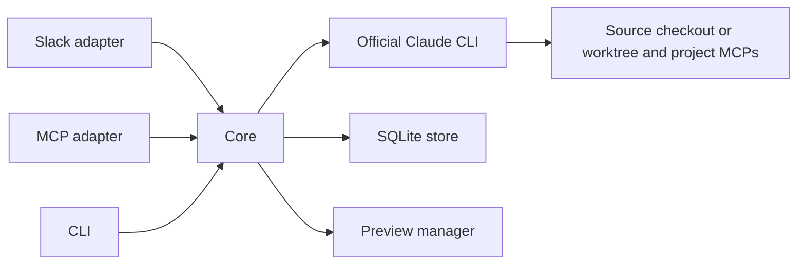

# Regent architecture

Regent is one runtime with Slack, MCP and CLI interfaces. The official Claude Code CLI
executes agent work; project repositories supply their own instructions, skills and MCPs.
Branded client distributions live in their owners' repositories, independently of the execution engine.

## Request flow

Adapters authenticate the caller, translate input into `Inbound` and present `Output`.
The core owns run/session state, cancellation, budgets, project selection and tool policy.
An adapter cannot authorize an operation merely by hiding its button or tool description.
Transport-specific checks coexist with core authorization and validated tool arguments.

## Module boundaries

| Location                                           | Responsibility                                                                        |
| -------------------------------------------------- | ------------------------------------------------------------------------------------- |
| `src/server.ts`, `src/mcp-server.ts`, `src/cli.ts` | Stable executable entrypoints.                                                        |
| `src/runtime.ts`, `src/startup.ts`                 | Shared server composition, CLI compatibility, validated ports and cleanup.            |
| `src/core/`                                        | Runs, sessions, history, project context, shared activity views and tool schemas.     |
| `src/execution/`                                   | Official CLI subprocess, event decoding, environment boundaries and composed prompts. |
| `src/adapters/slack/`                              | Slack events, identities, message formatting, streaming and reconnects.               |
| `src/adapters/mcp/`                                | External MCP tools, OAuth, client bridge and progress resources.                      |
| `src/adapters/http*.ts`                            | Loopback HTTP transport and connection lifecycle.                                     |
| `src/storage/`                                     | SQLite state, durable deliveries and shared redaction.                                |
| `src/previews/`                                    | Allocation, process/listener ownership, expiration and HTTP/WebSocket proxy.          |
| `plugins/executor/`                                | Executor protocol, default communication policy and permission hooks.                 |
| `plugins/regent/`                                  | Generic client manifest, delegation skill and installation guide.                     |

The core and storage do not import Slack/MCP SDKs or adapter implementations. CI checks this
boundary. Configuration, the runtime and adapters assemble implementations; there is no
service locator or separate daemon for each interface. The same SQLite file has one runtime
writer. CLI checks alongside a running server use a separate `REGENT_DB`.

## Lifecycle and state

Slack and MCP server modes share `createRuntime`. Startup acquires the SQLite runtime claim,
starts configured listeners and adapters, then recovers interrupted work. Failed startup
cleans up resources already created. The access-policy SIGHUP handler belongs to this runtime and is removed first, including failed startup.
Idempotent shutdown cancels work, closes preview
connections, drains durable output, stops Slack, closes HTTP and finally closes SQLite.
WebSocket upgrades are closed too; HTTP server close alone is insufficient.

Preserve `log/v2.sqlite`: its historical filename is part of deployed instance configuration.
Schema migrations are versioned in the store. Keep migrations compatible with existing state;
folder moves do not justify deleting databases, conversations or worktrees. Back up SQLite before
a schema upgrade; older runtimes reject newer schema versions, so do not downgrade against a
newer live database or restore an old snapshot over newly accepted work.

## Execution and data boundaries

The runner launches the unmodified official CLI. Query runs start in the selected source
checkout without allocating a worktree; editing runs create/reuse the conversation worktree.
Queries after an edit read that existing worktree. `src/core/execution-context.ts` selects the
location and `conversations.session_cwd` binds the persisted CLI session to it (schema 12).
A directory change starts a fresh CLI session with a bounded prior-request/result handoff;
the Regent conversation, history, caller and queued work remain the same. Legacy sessions
resume only when their existing worktree matches; a removed worktree is not recreated for a query.

Slack history has no conversation-wide 2,000-message or 200,000-character rejection.
The redacted snapshot is retained for the run; previously delivered messages are filtered
before packing recent context. The prompt body has a 60,000-character history budget,
independent of Claude's token window. Omitted contents remain available through the internal
`regent_read_history` reader, in pages of at most 16,000 characters, scoped to the active
run token. Only complete delivered messages are acknowledged. Missing history and pagination
failures remain explicit errors, rather than silently returning an incomplete snapshot.

The official CLI still owns automatic compaction. A failed resumed execution may retry once
in a fresh CLI session only for a recognized context overflow, before any agent tool use,
with current authorization and remaining time/cost budget. The conversation, intent,
repository environment and worktree remain unchanged; the retry receives prior decisions,
bounded history and the original request. A known-full session is detached for the next
human continuation when recovery is unsafe or fails. Its transcript and project files are
not deleted. Quota, authentication, rate, budget and unknown compaction failures do not
trigger this recovery. The total run deadline also bounds history loading.

`execution_failure` events distinguish provider context, provider quota, request rate,
authentication, Regent budget and Slack history failures. The runner preserves error result
text even when the CLI reports subtype `success` and exits nonzero. Deadline and
inactivity interruptions, unexpected process exits, invalid events and startup failures
also produce a terminal notice marking the work incomplete. A user stop takes precedence
over a concurrent executor error, preserves queued work and does not trigger recovery.
Slack persists terminal notices through durable delivery; MCP clients must report failures
instead of presenting a partial `result` as completed work. Failed and interrupted MCP run summaries expose optional
`failure.source`, `failure.code` and `failure.message`, including provider reset text when
available. Cost and token usage cover all attempts; successful recovery is not reported as
a terminal failure. Tests simulate these conditions and do not claim to exhaust a real
provider context window or subscription quota.

Query mode limits native built-ins to readers, skill loading and MCP discovery. Core/hook
policy denies shell execution, writers, delegation, preview mutations and self-promotion, and constrains
MCP operations to query conventions. `regent_git_read` executes bounded read-only Git argv
without a shell, disabling executable Git filters, fsmonitor and external diff/textconv.
It receives a minimal environment, not transport credentials. Trusted project hooks and MCP
implementations still execute under the operator's account; these guards are not an OS sandbox.
External services/database credentials must enforce their own data permissions.

The selected project's environment and connections load in both modes, preserving shared
root context for registered Git submodules. Query reads never prepare nested worktrees;
editing preparation initializes the isolated checkouts at pinned commits.
On resume, preparation also copies newly provisioned ignored setup files listed in each
submodule's `.worktreeinclude`, while preserving files already present in the worktree.
Independent repositories get their own context and connections. MCP availability inside the
executor is independent of the host chat's connections. Tools and public session contracts
remain compatible when source files move.

The initial request selects the conversation's project. Later explicit selections and
`regent_use_repo` may resolve services and registered submodules in that same project,
but reject a different independent project before changing state or queuing work. The
user starts a new conversation/thread for that project; MCP clients use `regent_start`
with `repo`. Execution-profile changes within the selected project retain their normal
handoff and authorization checks.

Executor instructions guide code changes through investigation, implementation and validation.
The optional `regent_status.phase` labels transitions for immediate progress updates; repeated
updates remain throttled. A phase label neither authorizes an action nor proves a check passed.
It is presentation metadata for the active run, not a persisted workflow or approval gate.

Prompts guide behavior; hooks and authorization enforce their documented checks. Hooks are
not an operating-system sandbox. Never read or transfer Claude credentials. Keep runtime
secrets out of client plugins. Tool event persistence retains activity metadata and allowlisted
command summaries; raw tool arguments and results are not retained. Structured secret keys and
text patterns are redacted before persistence. Arbitrary unlabelled prose is not guaranteed to
be secret-free, so avoid collecting unnecessary content.

Previews preserve application-owned login and authorization. Publication and routing verify
that the listening socket belongs to the authorized process group in the worktree. Linux uses
`/proc`; macOS uses `lsof`/`ps`. Lookup failures deny routing. Expiry terminates only the owned
process group. Closing the gateway preserves preview records/processes for restart recovery.
The external reverse proxy publishes only MCP/OAuth routes; internal tool and health routes stay local.
The core supplies `preview_policy` to the executor: `visual_changes` for editing with a
configured gateway, `status_only` for queries with that gateway, otherwise `unavailable`.
The executor includes a preview by default for user-visible or interactive changes unless
the user opts out; project context determines relevance across frameworks. Internal-only
changes do not require previews. Blocked visual review remains explicit. This policy guides
execution and does not relax query permissions or authorize production deployment.
Explicit requests to run a preview use the operational `task` profile; questions about previews
and explicit query limits remain read-only. MCP status includes an additive `preview` field for
the current conversation, independently of the agent's final prose. It exposes only readiness,
expiry and a URL while the published process/listener is still owned and live. It is not a
snapshot of the requested run's revision or proof that a specific application route works;
the executor verifies the public route and preserves application authentication before delivery.
`preview_available` reports gateway configuration separately from preview readiness; internal
status reports `not_reserved` and the next allowed action when no preview exists yet.

## Configuration and runtime resources

`access_policy_file` optionally selects a separate, strictly validated `config/access.yaml`.
The runtime loads it before accepting requests and reloads it only on an explicit `SIGHUP`, without
restarting executors. File edits alone do not apply permissions; there is no polling or access-file
watcher. `src/access.ts` owns file validation and reloading; `src/core/access-policy.ts` exposes
an immutable shared snapshot to the core, Slack and OAuth. Invalid runtime edits retain the last
valid snapshot. Queued authorization is per run author; withdrawal interrupts only those queued
runs and preserves active runs. CLI loads once. Legacy inline lists stay boot-only. See the
[configuration guide](config/README.md) for migration, list semantics and path resolution.

`config/regent.yaml`, `config/access.yaml`, custom communication instructions and `.env` belong to the operator and
remain ignored. `config/regent.example.yaml` is the public template. The bundled default policy
is `plugins/executor/communication.md`; `config/communication.example.md` links to it as a copyable
template. Mandatory runtime resources ship with Docker and are tested inside the built image.

## Extending Regent

- A channel integration supplies `Inbound`/`Output` and caller identity; reuse core execution.
- A core tool defines its schema in `src/core/tool-schemas.ts`, then implements authorization
  and behavior in the core. Both HTTP registration and dispatch use the same schema.
- A lifecycle resource belongs to shared runtime cleanup, including failed startup.
- A persistence change requires migration and restart/recovery tests against previous state.
- A client skill change belongs in its client plugin; project-specific instructions stay in
  the target repository. Executor hooks do not embed business dashboards or data dictionaries.

Use focused regression tests for changed behavior. Fixtures simulate providers without tokens;
real provider checks are opt-in under `test/smoke/`. See [CONTRIBUTING.md](CONTRIBUTING.md).
