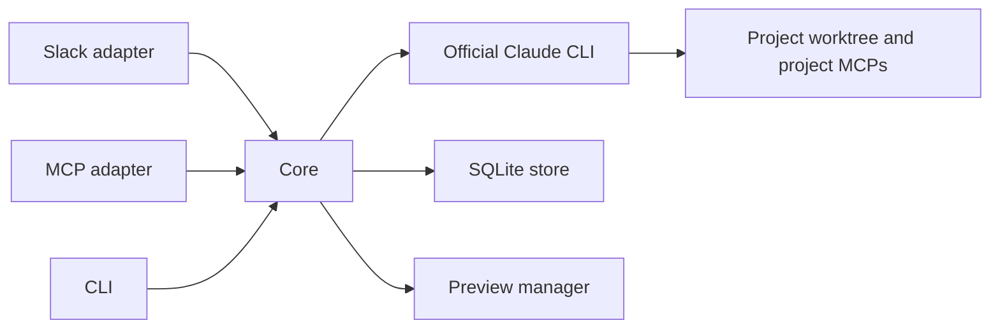

# Regent architecture

Regent is one runtime with Slack, MCP and CLI interfaces. The official Claude Code CLI
executes agent work; project repositories supply their own instructions, skills and MCPs.
Talently Code is a branded client distribution, not a dependency of the execution engine.

## Request flow

Adapters authenticate the caller, translate input into `Inbound` and present `Output`.
The core owns run/session state, cancellation, budgets, project selection and tool policy.
An adapter cannot authorize an operation merely by hiding its button or tool description.
Transport-specific checks coexist with core authorization and validated tool arguments.

## Module boundaries

| Location                                           | Responsibility                                                                        |
| -------------------------------------------------- | ------------------------------------------------------------------------------------- |
| `src/server.ts`, `src/mcp-server.ts`, `src/cli.ts` | Stable executable entrypoints.                                                        |
| `src/runtime.ts`, `src/startup.ts`                 | Shared server composition, CLI compatibility, validated ports and cleanup.            |
| `src/core/`                                        | Runs, sessions, history, project context, shared activity views and tool schemas.     |
| `src/execution/`                                   | Official CLI subprocess, event decoding, environment boundaries and composed prompts. |
| `src/adapters/slack/`                              | Slack events, identities, message formatting, streaming and reconnects.               |
| `src/adapters/mcp/`                                | External MCP tools, OAuth, client bridge and progress resources.                      |
| `src/adapters/http*.ts`                            | Loopback HTTP transport and connection lifecycle.                                     |
| `src/storage/`                                     | SQLite state, durable deliveries and shared redaction.                                |
| `src/previews/`                                    | Allocation, process/listener ownership, expiration and HTTP/WebSocket proxy.          |
| `plugins/executor/`                                | Executor protocol, default communication policy and permission hooks.                 |
| `plugins/talently-code/`                           | Public client manifest, delegation skill and installation guide.                      |

The core and storage do not import Slack/MCP SDKs or adapter implementations. CI checks this
boundary. Configuration, the runtime and adapters assemble implementations; there is no
service locator or separate daemon for each interface. The same SQLite file has one runtime
writer. CLI checks alongside a running server use a separate `REGENT_DB`.

## Lifecycle and state

Slack and MCP server modes share `createRuntime`. Startup acquires the SQLite runtime claim,
starts configured listeners and adapters, then recovers interrupted work. Failed startup
cleans up resources already created. Idempotent shutdown cancels work, closes preview
connections, drains durable output, stops Slack, closes HTTP and finally closes SQLite.
WebSocket upgrades are closed too; HTTP server close alone is insufficient.

Preserve `log/v2.sqlite`: its historical filename is part of deployed instance configuration.
Schema migrations are versioned in the store. Keep migrations compatible with existing state;
folder moves do not justify deleting databases, conversations or worktrees.

## Execution and data boundaries

The runner launches the unmodified official CLI in a conversation worktree. It loads the
selected project's environment, preserving shared context for registered Git submodules.
Independent repositories get their own context and connections. MCP availability inside the
executor is independent of the host chat's connections. Tools and public session contracts
remain compatible when source files move.

Prompts guide behavior; hooks and authorization enforce their documented checks. Hooks are
not an operating-system sandbox. Never read or transfer Claude credentials. Keep runtime
secrets out of client plugins. Tool event persistence retains activity metadata and allowlisted
command summaries; raw tool arguments and results are not retained. Structured secret keys and
text patterns are redacted before persistence. Arbitrary unlabelled prose is not guaranteed to
be secret-free, so avoid collecting unnecessary content.

Previews preserve application-owned login and authorization. Publication and routing verify
that the listening socket belongs to the authorized process group in the worktree. Linux uses
`/proc`; macOS uses `lsof`/`ps`. Lookup failures deny routing. Expiry terminates only the owned
process group. Closing the gateway preserves preview records/processes for restart recovery.
The external reverse proxy publishes only MCP/OAuth routes; internal tool and health routes stay local.

## Configuration and runtime resources

`config/regent.yaml`, custom communication instructions and `.env` belong to the operator and
remain ignored. `config/regent.example.yaml` is the public template. The bundled default policy
is `plugins/executor/communication.md`; `config/communication.example.md` links to it as a copyable
template. Mandatory runtime resources ship with Docker and are tested inside the built image.

## Extending Regent

- A channel integration supplies `Inbound`/`Output` and caller identity; reuse core execution.
- A core tool defines its schema in `src/core/tool-schemas.ts`, then implements authorization
  and behavior in the core. Both HTTP registration and dispatch use the same schema.
- A lifecycle resource belongs to shared runtime cleanup, including failed startup.
- A persistence change requires migration and restart/recovery tests against previous state.
- A client skill change belongs in its client plugin; project-specific instructions stay in
  the target repository. Executor hooks do not embed business dashboards or data dictionaries.

Use focused regression tests for changed behavior. Fixtures simulate providers without tokens;
real provider checks are opt-in under `test/smoke/`. See [CONTRIBUTING.md](CONTRIBUTING.md).
